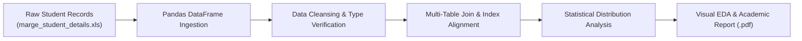

<p align="center">
  
</p>

<p align="center">
  
  
  
  
</p>

<a id="overview"></a>
## 📖 Executive Summary & Overview

Educational datasets collected across distributed university databases frequently suffer from fragmentation, disparate primary keys, missing attribute fields, and disparate table schemas. Reconciling student demographic profiles with examination records is an essential exploratory data science (EDA) task required before training predictive retention models.

The **Introduction to Data Science Assignment** (`IDS-ASSIGNMENT`) presents an end-to-end exploratory pipeline developed for BCA Semester 2 coursework at Alliance University. The project features automated merging of disjoint student tables (`marge_student_details.xls`), data imputation, distribution analysis, and visual reporting documented in `SEM2 ASS-1.ipynb` and `IDS ASS-1 , SEM-2.pdf`.

<a id="toc"></a>
## 📑 Table of Contents

- [📖 Executive Summary & Overview](#overview)
- [🎯 Key Features & Capabilities](#features)
- [🏗️ System Architecture & Pipeline](#architecture)
- [🛠️ Tech Stack Breakdown](#tech-stack)
- [⚙️ Reproducible Quickstart & Setup](#setup)
- [📁 Project Directory Layout](#project-layout)
- [👨‍💻 Author & Contributions](#author)

<a id="features"></a>
## 🎯 Key Features & Capabilities

- **Relational Data Merging:** Automated inner and outer joins combining disparate student demographic records with grade sheets.
- **Missing Value Imputation:** Statistical imputation (mean/median/mode) and outlier boundary detection.
- **Descriptive Statistical Modeling:** Summary statistics computation (variance, standard deviation, interquartile ranges).
- **Academic Visualization:** Bar charts, histograms, and boxplots visualizing performance trends across academic departments.

<a id="architecture"></a>
## 🏗️ System Architecture & Pipeline



<a id="tech-stack"></a>
## 🛠️ Tech Stack Breakdown

| Technology | Purpose | Implementation Detail |
| :--- | :--- | :--- |
| **Environment** | Jupyter Notebook | Interactive literate programming environment |
| **Data Munging** | Pandas | Relational merges, grouping, aggregation |
| **Numerical Processing** | NumPy | Vectorized arrays, mathematical transformations |
| **Visual Analytics** | Matplotlib / Seaborn | Histograms, scatter plots, and correlation visuals |

<a id="setup"></a>
## ⚙️ Reproducible Quickstart & Setup

### Prerequisites
- Python 3.8+ with virtual environment

```bash
# 1. Clone repository
git clone https://github.com/Amaraiah11/IDS-ASSIGNMENT.git
cd IDS-ASSIGNMENT

# 2. Setup virtual environment
python -m venv venv
venv\Scripts\activate   # Windows

# 3. Install packages
pip install pandas numpy matplotlib seaborn openpyxl xlrd jupyter

# 4. Launch notebook
jupyter notebook "SEM2 ASS-1.ipynb"
```

<a id="project-layout"></a>
## 📁 Project Directory Layout

```text
IDS-ASSIGNMENT/
├── IDS ASS-1 , SEM-2.pdf          # Formal academic assignment documentation
├── marge_student_details.xls      # Excel dataset containing student records
├── SEM2 ASS-1.ipynb               # Complete Jupyter computational notebook
└── README.md                      # Comprehensive laboratory documentation
```

<a id="author"></a>
## 👨‍💻 Author & Contributions

This project is developed and maintained with high technical rigour by **Amaraiah C**, Software Engineer and Data Analytics Practitioner studying Bachelor of Computer Applications (BCA) at Alliance University.

- 🌐 **GitHub:** [@Amaraiah11](https://github.com/Amaraiah11)
- 💼 **LinkedIn:** [Connect on LinkedIn](https://www.linkedin.com/in/amaraiah-c/)
- 📧 **Institutional Contact:** `camaraiahBCA24@ced.alliance.edu.in`

### 🤝 Contribution Guidelines
Contributions, bug reports, and architectural discussions are welcome!
1. **Fork** the repository: `https://github.com/Amaraiah11/IDS-ASSIGNMENT`
2. **Branch**: `git checkout -b feature/your-feature-name`
3. **Commit**: `git commit -m "feat: enhance feature logic"`
4. **Push**: `git push origin feature/your-feature-name`
5. **Open Pull Request** against the `main` branch.

---

<p align="center">
  <b>⭐ If this codebase or documentation assisted your engineering workflows, please star the repository! ⭐</b>
</p>

<p align="center">
  
</p>
