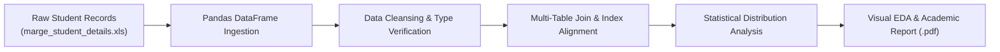

# 📊 Introduction to Data Science — Student Performance Analytics & Relational Merging

<p align="center">
  
</p>

<p align="center">
  <b>Exploratory Data Science Pipeline: Automated Relational Table Merging, Statistical Missingness Imputation, and Departmental Performance Analytics.</b>
</p>

<p align="center">
  
  
  
  
</p>

<p align="center">
  
</p>

---

<a id="table-of-contents"></a>
## 📌 Table of Contents

- [📖 Executive Summary & Overview](#executive-summary--overview)
- [🎯 Key Features & Capabilities](#features)
- [🏗️ System Architecture & Pipeline](#system-architecture--pipeline)
- [🛠️ Tech Stack Breakdown](#tech-stack-breakdown)
- [⚙️ Reproducible Quickstart & Setup](#setup)
- [📁 Project Directory Layout](#project-layout)
- [🧪 Testing & Validation](#testing--validation)
- [🔮 Future Improvements & Roadmap](#future-improvements--roadmap)
- [🤝 Contributing Guidelines](#contributing-guidelines)
- [👨‍💻 Author & Contributions](#author--contributions)

---

<a id="executive-summary--overview"></a>
## 📖 Executive Summary & Overview

Educational datasets collected across distributed institutional databases frequently suffer from fragmentation, disparate primary keys, missing attribute fields, and non-aligned schemas. Reconciling student demographic profiles with examination records is an essential exploratory data science (EDA) task required before training predictive retention models.

The **Introduction to Data Science Assignment** (`IDS-ASSIGNMENT`) presents an end-to-end exploratory pipeline developed by **Amaraiah C** for BCA Semester 2 coursework at Alliance University. The project features automated merging of disjoint student tables (`marge_student_details.xls`), data imputation, distribution analysis, and visual reporting documented in `SEM2 ASS-1.ipynb` and `IDS ASS-1 , SEM-2.pdf`.

---

<a id="key-features--capabilities"></a>
## 🎯 Key Features & Capabilities

### 🔗 1. Relational Data Merging
- Inner and outer joins unifying student demographic records with grade sheets.

### 🧹 2. Missing Value Imputation
- Statistical imputation (mean/median/mode) and outlier boundary isolation.

### 📈 3. Visual Statistical Profiling
- Histograms, bar charts, and boxplots visualizing performance trends across academic departments.

---

<a id="system-architecture--pipeline"></a>
## 🏗️ System Architecture & Pipeline



---

<a id="tech-stack-breakdown"></a>
## 🛠️ Tech Stack Breakdown

| Technology | Purpose | Implementation Detail |
| :--- | :--- | :--- |
| **Environment** | Jupyter Notebook | Interactive literate programming environment |
| **Data Munging** | Pandas | Relational merges, grouping, aggregation |
| **Numerical Processing** | NumPy | Vectorized arrays, mathematical transformations |
| **Visual Analytics** | Matplotlib / Seaborn | Histograms, scatter plots, and correlation visuals |

---

<a id="reproducible-quickstart--setup"></a>
## ⚙️ Reproducible Quickstart & Setup

### Prerequisites
- Python 3.8+ with virtual environment

```bash
# 1. Clone repository
git clone https://github.com/Amaraiah11/IDS-ASSIGNMENT.git
cd IDS-ASSIGNMENT

# 2. Setup virtual environment
python -m venv venv
venv\Scripts\activate   # Windows

# 3. Install packages
pip install pandas numpy matplotlib seaborn openpyxl xlrd jupyter

# 4. Launch notebook
jupyter notebook "SEM2 ASS-1.ipynb"
```

---

<a id="project-directory-layout"></a>
## 📁 Project Directory Layout

```text
IDS-ASSIGNMENT/
├── IDS ASS-1 , SEM-2.pdf          # Formal academic assignment documentation
├── marge_student_details.xls      # Excel dataset containing student records
├── SEM2 ASS-1.ipynb               # Complete Jupyter computational notebook
└── README.md                      # Comprehensive laboratory documentation
```

---

<a id="testing--validation"></a>
## 🧪 Testing & Validation

- Verified primary key join alignment produces zero duplicate student records or unintended Cartesian product rows.

---

<a id="future-improvements--roadmap"></a>
## 🔮 Future Improvements & Roadmap

- [ ] Build a Logistic Regression model to predict student completion rates.
- [ ] Export interactive HTML profiling reports using Sweetviz or YData-Profiling.

---

<a id="author--contributions"></a>
## 👨‍💻 Author & Contributions

This project is developed and maintained with rigorous engineering standards by **Amaraiah C**, Software Developer and Applied Data Analytics Practitioner studying Bachelor of Computer Applications (BCA) at Alliance University, Bangalore.

- 🌐 **GitHub Profile:** [@Amaraiah11](https://github.com/Amaraiah11)
- 💼 **LinkedIn Profile:** [Connect on LinkedIn](https://www.linkedin.com/in/amaraiah-c/)
- 📧 **Institutional Email:** `camaraiahBCA24@ced.alliance.edu.in`

### 🤝 Contributing Guidelines
Contributions, bug reports, and architectural discussions are welcome!
1. **Fork** the repository: `https://github.com/Amaraiah11/IDS-ASSIGNMENT`
2. **Create a Feature Branch:**
   ```bash
   git checkout -b feature/your-feature-name
   ```
3. **Commit Your Enhancements:**
   ```bash
   git commit -m "feat: enhance feature logic"
   ```
4. **Push to Your Branch:**
   ```bash
   git push origin feature/your-feature-name
   ```
5. **Open a Pull Request** against the `main` branch.

---

<p align="center">
  <b>⭐ If this codebase or documentation assisted your engineering workflows, please star the repository! ⭐</b>
</p>

<p align="center">
  
</p>
